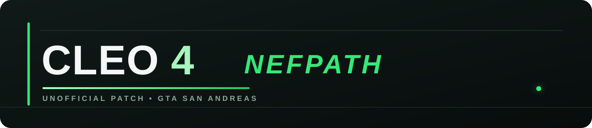

<p align="center">
  
</p>

<p align="center"><strong>Unofficial CLEO 4.4.4 development patch for GTA San Andreas</strong></p>
## Базовая тестовая точка v1.0 TEST

**Baseline:** `151936070c594fe801ffec48b11bf17527b4b00d`

Это зафиксированная тестовая исходная точка (`151936070c594fe801ffec48b11bf17527b4b00d`), а не описание всей текущей ветки. После неё в `main` добавлены дальнейшие изменения разработки, перечисленные в конце этого файла. Baseline полезен для воспроизводимого сравнения, но его не следует путать с текущим состоянием `main`.

### Что зафиксировано

- `HookSystem` и работа хуков.
- Исправления памяти/lifecycle для `CCustomScript`.
- `0E6F` — создание child custom-script из label.
- `0E70` — получение последнего созданного custom-script.
- `0A93` — завершение текущего custom-thread.
- `0AB1` / `0AB2` — вызов и возврат `ScmFunction`.
- `ScmFunction` lifecycle, восстановление и очистка scope.
- Сохранение child-state в `csN.children.sav`.
- Сохранение состояния `ScmFunction` в `csN.functions.sav`.
- Восстановление активного `ScmFunction`/scope после Save/Load.
- Исправление восстановления string pointers после Load.
- Диагностический лог `cleo_diagnostic.log`.
- Проверенная схема parent → child → Save → Load → restore.

## Save/Load

Используются отдельные sidecar-файлы:

```text
cleo/cleo_saves/csN.sav
cleo/cleo_saves/csN.children.sav
cleo/cleo_saves/csN.functions.sav
```

Legacy `csN.sav` не заменяется новым форматом для этих функций.

`functions.sav` хранит состояние `ScmFunction`; при восстановлении исправлено перепривязывание указателей строковых параметров к новой `std::string` storage.

## Runtime target

- GTA San Andreas 1.0 US
- Win32
- Release / GTASA
- Visual Studio 2022 / MSVC v143

## Тестовая цепочка

```text
HookSystem
   ↓
0E6F
   ↓
CCustomScript parent/child
   ↓
0AB1 → ScmFunction → 0AB2
   ↓
Save
   ├── csN.sav
   ├── csN.children.sav
   └── csN.functions.sav
   ↓
Load
   ↓
restore child + ScmFunction + active scope
```

## Подтверждённые исправления

`151936070` исправляет сборку восстановления `ScmFunction` под MSVC. В `source/CScriptEngine.cpp` восстановление string locals больше не использует `std::map`; применяются пары старых/новых адресов и единый `restoreStringPointer`, который обрабатывает как `savedTls`, так и текущие 32 locals. Это устраняет проблему перепривязки указателей после восстановления. 

Предыдущий этап `d72b4a6` завершил sidecar Save для `ScmFunction`, включая безопасное имя `csN.functions.sav` и бинарные Read/Write helpers.

## Возврат к v1.0 TEST

Эталонный commit:

```text
151936070c594fe801ffec48b11bf17527b4b00d
```

В Git:

```powershell
git fetch origin
git checkout main
git reset --hard 151936070c594fe801ffec48b11bf17527b4b00d
```

Или переключиться на защищённую тестовую ветку:

```powershell
git fetch origin
git checkout v1.0-test
```

## Важно

**v1.0 TEST** — тестовый baseline, а не финальный релиз. Сам baseline остаётся зафиксированным указанным выше коммитом; текущая ветка `main` содержит последующие изменения разработки.

## Направление проекта и исследование CLEO 5

Проект развивается на основе собственного исследования **CLEO 4.4.4**, а также изучения исходного кода и архитектурных решений **CLEO 5**.

Исходники CLEO 5 используются как исследовательская база и источник архитектурных идей, **но проект не является копированием CLEO 5**. Цель — улучшить именно CLEO 4.4.4, сохранив его legacy-основу и совместимость со старыми скриптами.

Основная концепция:

```text
CLEO 4.4.4 Legacy
      │
      ├── старые opcode
      ├── .cs / .cs3 / .cs4
      ├── legacy Execution Engine
      └── совместимый ABI
             │
             ▼
     Исследование CLEO 5
     исходники + архитектура
             │
             ▼
       Адаптация идей
             │
             ▼
      Улучшенный CLEO 4
             │
      ┌──────┼───────────┐
      ▼      ▼           ▼
   Plugin  DebugUtils  Memory
     SDK                Manager
                          │
                          ▼
                   Custom Runtime
```

### Что именно улучшается

- сохранение старых CLEO 4 opcode;
- сохранение совместимости `.cs/.cs3/.cs4`;
- сохранение legacy `CRunningScript` и существующей модели выполнения;
- перенос полезных архитектурных решений в более современную модульную систему;
- развитие нового Plugin SDK;
- централизованная диагностика через DebugUtils;
- отдельная CLEO Memory Manager;
- контролируемый GTA/CLEO Bridge;
- подготовка Custom Runtime и Custom VM;
- улучшение существующего однопоточного исполнения без изменения поведения legacy-скриптов.

### Главный принцип

> **Не заменить CLEO 4 на CLEO 5, а развить CLEO 4.4.4 с учётом результатов исследования CLEO 5.**

Новые подсистемы должны добавляться рядом со старым ядром и не ломать существующие скрипты и opcode.


## Audio: legacy + extended API

В ветке `test-xx02` Audio развивается по комбинированной схеме.

### Legacy CLEO 4

Старые аудио opcode остаются в основном ядре и сохраняют свою интерфейсную семантику:

`0AAC`, `0AAD`, `0AAE`, `0AAF`, `0AB9`, `0ABB`, `0ABC`, `0AC0`, `0AC1`, `0AC2`, `0AC3`, `0AC4`, `0AC5`.

Для `0AAD` сохранены отдельные legacy-пути `LegacyPlay()` и `LegacyStop()`, чтобы обновление внутреннего audio runtime не меняло старое поведение скриптов.

### Updated BASS

`third-party/bass/` обновлён комплектом `bass.dll`, `bass.lib` и `bass.h` из актуального исследуемого baseline CLEO 5.

При этом CLEO 4 не запускает второй BASS engine: один существующий `CSoundSystem` остаётся владельцем stream handles.

#### BASS и Mod Loader

BASS делит аудиоустройство с самой GTA SA и с Mod Loader, поэтому завершение BASS (`BASS_Free`) из пути выключения CLEO приводит к deadlock — после этого пропадает весь игровой звук (совпадает с CLEO4 issue #87 «game without sound» и CLEO5 #223). CLEO 5 убрал этот вызов в коммите `a66999582` («Fix deadlock inside BASS library finalization», пометка «causes deadlock with ModLoader»).

В этом патче `CSoundSystem::~CSoundSystem()` повторяет решение CLEO 5: `BASS_Free()` не вызывается, DLL остаётся загруженной до завершения процесса. Потоки (`streams`) по-прежнему освобождаются.

### Audio.cleo

Добавлен отдельный plugin:

`demo_plugins/Audio/Audio/Audio.vcxproj`

Он регистрирует новые аудио opcode:

`2500`–`250D`, включая собственный `250D` для управления looping.

Новые функции работают с теми же stream handles, которые возвращаются старым `0AAC/0AC1`.

Таким образом:

```text
Legacy 0AAC/0AC1
       │
       ▼
 CLEO 4 CAudioStream
       │
       ├── old 0AAD/0AAE/0AAF...
       │
       └── Audio.cleo
              │
              └── 2500–250C
```

Это позволяет постепенно переносить полезные Audio-возможности из исследования CLEO 5 в CLEO 4, не заменяя legacy audio layer.

Исторически интеграционный тест находился в `tests/AUDIO_25XX_TEST.cs`; папка `tests/` удалена из текущей ветки, поэтому файл здесь не поставляется.


## Текущее состояние разработки — test-xx02

На этом этапе ветка `test-xx02` содержит проверенное развитие проекта поверх базового CLEO 4.4.4. Основной принцип сохраняется: улучшать CLEO 4, не ломая legacy-скрипты, legacy opcode и существующую модель совместимости.

### DebugUtils — самостоятельная система диагностики

Добавлен и расширен отдельный `DebugUtils.cleo`, предназначенный для лёгкой диагностики CLEO/GTA SA без постоянной тяжёлой crash-аналитики в обычном игровом цикле.

Что уже сделано:

- отдельные структурированные логи для core, scripts, memory, diagnostics и crash reports;
- фоновая запись script-log через ограниченную очередь, чтобы диск не обслуживался внутри script callback;
- дедупликация повторяющихся сообщений и ротация core-log на 1 MiB вместо старого жёсткого лимита;
- отдельный crash handler с lazy-подключением DbgHelp только в crash path;
- подробный снимок `EXCEPTION`, `FAULT`, `CPU`, `INSTRUCTION`, `MEMORY`, `PROCESS MEMORY`;
- сохранение CLEO-контекста: script, opcode, script offset, opcode result и game tick;
- встроенная verified CrashInfo база с exact-address/module/RVA/context matching;
- отдельная `CLEO-CrashAuto.txt` для новых наблюдений без автоматического превращения их в verified записи;
- русская локализация CrashInfo и crash window;
- честное разделение контекста и причинности: script/last opcode не объявляются причиной без подтверждения;
- crash-only StackWalk64/legacy/EBP попытки с `STACK_SCAN` fallback;
- `STACK_SCAN` помечается как `heuristic=1`, а faulting EIP всегда сохраняется как frame `#00`;
- добавлен `fault_ip_present=1/0`, чтобы отчёт явно показывал наличие faulting IP в backtrace;
- heuristic backtrace не используется для загрязнения verified CrashInfo matcher/fingerprint.

Подтверждённый тестовый результат для воспроизводимого `0xC0000005`:

```text
status=OK method=STACK_SCAN heuristic=1
frames=25
fault_ip_present=1
#00 address=0x005D95CE module=gta_sa.exe rva=0x001D95CE
```

Это означает, что при отсутствии пригодного обычного unwind DebugUtils всё равно получает полезный crash snapshot и эвристический стек, не выдавая его за гарантированный call chain.

### Audio.cleo — расширенный аудио API

Добавлен отдельный plugin `Audio.cleo`, который расширяет аудио-возможности CLEO 4, не создавая второй audio engine и не дублируя владение BASS stream handles.

Добавлены расширенные opcode `2500`–`250D`:

- `2500` — playing state;
- `2501` — duration;
- `2502` / `2503` — speed read/set;
- `2504` — volume transition;
- `2505` — speed transition;
- `2506` — 3D source size;
- `2507` / `2508` — normalized progress read/set;
- `2509` / `250A` — stream type read/set;
- `250B` / `250C` — progress in seconds read/set;
- `250D` — looping control.

`2500`–`250C` реализуют расширенный CLEO 5-style набор управления уже существующими CLEO 4 stream handles. `250D` — наш собственный дополнительный opcode для управления looping.

Для Sanny Builder добавлены соответствующие записи в `opcodes.txt` и `SASCM.INI`. В предыдущем состоянии репозитория использовался интеграционный тест `tests/AUDIO_25XX_TEST.cs`; файл удалён вместе с папкой `tests/`.

### Audio core / API

Для нового plugin API добавлен отдельный `CAudioPluginAPI`, а существующий `CSoundSystem` расширен так, чтобы новый Audio.cleo работал через общий CLEO 4 audio layer. Обновлён bundled BASS baseline; второй BASS engine в Audio.cleo не создаётся.

## Что ещё осталось сделать DebugUtils

Текущая crash-диагностика уже рабочая, поэтому дальнейшие задачи — улучшения качества, а не обязательное исправление базового crash path:

- добавить optional `SymFromAddr` и вывод имён функций там, где символы реально доступны;
- при необходимости расширить Crash report списком загруженных `.asi` / `.cleo` модулей;
- добавить opt-in `OpcodeHistory` с несколькими последними opcode в crash context;
- сделать diagnosis информативнее, отделяя known CrashInfo signature, stack presence и фактическую причинность;
- улучшить качество heuristic stack scan без переименования его в полноценный unwind;
- расширить crash test matrix на дополнительные воспроизводимые типы аварий и unknown-crash сценарии;
- после накопления тестов зафиксировать финальный lightweight performance contract и завершённый статус DebugUtils.

### Что сознательно не входит в текущий DebugUtils

DebugUtils не пытается автоматически «чинить» GTA, не объявляет CLEO script виновным только по последнему opcode и не выдаёт heuristic stack scan за доказанную цепочку вызовов. Более глубокие game-specific hooks добавляются только под конкретно воспроизведённую проблему.

---

## Последнее обновление — слияние `bag101` в `main`

**Коммит слияния:** `be9a18de1133a705d7bdf9ac789d4300cc9c0769`  
**Pull Request:** [#5 — Speed up custom script processing; fix 0AB2/0AD1 with many scripts; memory reset](https://github.com/dima16263690d-prog/cleo4-unofficial-patch/pull/5)

Этот этап сосредоточен на производительности обработки custom scripts, исправлении ошибок при большом количестве потоков и управлении памятью. Он изменяет существующие opcode и runtime; **новые номера opcode этим слиянием не добавлялись**.

### Производительность custom scripts

- Добавлен быстрый путь для спящих обычных custom scripts: пока не наступил `WakeTime`, пропускается ненужное сохранение и восстановление состояния скрипта. Миссии и скрипты с особыми проверками продолжают использовать прежний путь.
- Повторно используются узлы списка текстур вместо постоянного удаления и создания узлов каждый кадр.
- Значения по умолчанию для 96 структур текстового вывода подготавливаются один раз и копируются блоком вместо повторной установки каждого поля.

### Исправления существующих opcode

- **`0AB2` — возврат из вызванной SCM-функции:** слот `ScmFunction` с ID `0` зарезервирован, поскольку ноль используется как признак отсутствия активной функции. Это устраняет конфликт, при котором один скрипт мог получить или удалить функцию другого скрипта.
- **`0AB1` / `0AB2` — вызов и возврат SCM-функций:** внутреннее хранилище `ScmFunction` увеличено с `0x400` до `0x4000` записей; это снижает риск исчерпания слотов при большом количестве вложенных вызовов и скриптов.
- **`0AD0`, `0AD1`, `0AD3` — текстовые сообщения:** вместо одного общего буфера используется кольцо из 16 буферов размером `0x100` байт для каждого соответствующего канала/стиля. Копирование ограничено безопасной длиной, а для `PrintBig` проверяется диапазон стиля 1–7. Это предотвращает перезапись одновременно отображаемых сообщений и переполнение старого буфера `0x80`.

Эти изменения исправляют реализацию существующих opcode и **не означают добавления новых opcode**.

### Управление памятью и очистка

- `CCleoMemoryManager::ReleaseOwner()` обходит только блоки памяти конкретного скрипта вместо полного списка выделений.
- При `GameEnd()` освобождаются также внутренние таблицы учёта памяти.
- После завершения игровой сессии вызывается уплотнение process/CRT heap через `HeapCompact`.
- При запуске записывается информация о флаге Large Address Aware игры и предпринимается настройка мягких лимитов working set процесса.
- Бюджет памяти стриминга (`CStreaming::ms_memoryAvailable`) ядро само не меняет. Плагин может запросить его через экспорт `CLEO_SetStreamingMemoryLimit(mb)`; запрос применяется при инициализации SCM (чтобы его не перезатёрла собственная инициализация движка). Значение только повышается, уже установленный больший лимит не уменьшается, для неизвестных версий игры адрес не изменяется. Настройку для пользователя предоставляет DebugUtils — ключ `StreamLimitMB` в `[DebugUtils.FrameTime]` (см. его README). Диагностика фактического потребления стриминга доступна в `cleo_frametime.log`.

### Стресс-тест

Ранее использовался стресс-тест создания 1000 дочерних custom scripts через `0E6F` (для этого opcode требуется CLEOPlus). Его файл `tests/STRESS_1000_THREADS.cs` удалён вместе с папкой `tests/` и в текущую ветку не входит.

### Статус проверки

В описании PR указано, что пункты оптимизации обработки спящих скриптов, повторного использования узлов текстур и копирования значений текстового вывода были проверены пользователем в игре. Остальные изменения управления памятью, `ScmFunction` и буферов сообщений на момент слияния **не были собраны и проверены в игре**. Поэтому это обновление нельзя считать подтверждением успешной сборки или полной стабильности; необходимы сборка Win32 Release и игровые тесты, включая стресс-тест.

## Совместимость с ASI Loader

Цель — чтобы `CLEO.asi` работал с разными реализациями ASI Loader, когда игрок выбирает и использует **один подходящий загрузчик**. CLEO не требует устанавливать оба загрузчика и не объединяет их между собой.

На текущем этапе предусмотрены два механизма загрузки:

- **Legacy/Silent ASI Loader** — обычная загрузка DLL; для него сохранён fallback через `DllMain`.
- **Ultimate ASI Loader (ThirteenAG)** — экспорт `InitializeASI` запускает CLEO после `LoadLibrary`. Вызов из `DllMain` подавляется, когда обнаружен маркер `IsUltimateASILoader`, чтобы не запускать CLEO преждевременно и не инициализировать его повторно.

Игрок сам выбирает загрузчик, совместимый с его игрой и модами. Поместите `CLEO.asi` в корневую папку игры. При использовании Ultimate ASI Loader оставьте `[GlobalSets] DontLoadFromDllMain=1` (значение по умолчанию), чтобы `InitializeASI` вызывался после освобождения Windows loader lock. Proxy-loader, которые заменяют одну и ту же системную DLL, не следует устанавливать одновременно — это отдельный вопрос конфигурации загрузчиков, а не требование CLEO.

Исходный код проверен статически. Отдельный запуск GTA SA 1.0 US с каждым загрузчиком ещё требуется проверить; совместимость со всеми существующими ASI Loader пока не подтверждена.

---

## Последнее обновление — слияние `perf/cscriptengine-indexed-registry` в `main`

**Дата:** 11 октября 2026 г.  
**Pull Request:** [#6 — Merge perf/cscriptengine-indexed-registry into main](https://github.com/dima16263690d-prog/cleo4-unofficial-patch/pull/6)  
**Коммит слияния:** `8b510ff3e773121a737cf498f8a6afa85cfec759`

В `main` объединены 56 коммитов рабочей ветки. Это крупный рефакторинг `CScriptEngine`, разбиение подсистемы custom opcode и диагностического `DebugUtils`, а также дальнейшие изменения управления памятью. Слияние подтверждено GitHub; успешная сборка и игровой тест этим фактом не подтверждаются.

### `CScriptEngine` — индексированный реестр скриптов

- Добавлены отдельные индексы зарегистрированных custom scripts, активных custom scripts и скриптов, ожидающих удаления.
- Добавлен индекс custom scripts по нормализованному имени. Основной поиск обычно выполняется за среднее `O(1)` вместо полного перебора списка.
- Сохранены правила совместимости: custom mission ищется первой, сравнение имён остаётся регистронезависимым через `_stricmp`, а при несовпадении индекса предусмотрен совместимый fallback-поиск.
- Очередь `pActiveScripts` остаётся авторитетной для порядка исполнения GTA: нативные скрипты сохраняют свой порядок, CLEO-скрипты добавляются после них.
- Код движка разделён на `CScriptEngine.Internal.h`, `CScriptEngine.Lifecycle.cpp`, `CScriptEngine.Registry.cpp`, `CScriptEngine.State.cpp` и `CScriptEngine.State.h`. Цель — отделить жизненный цикл, поиск/регистрацию и сохранение состояния без замены legacy-модели исполнения на многопоточную.

### Custom opcode — разделение по подсистемам

Большой `CCustomOpcodeSystem.cpp` разделён на тематические модули:

- `CCustomOpcodeSystem.Audio.cpp`
- `CCustomOpcodeSystem.Files.cpp`
- `CCustomOpcodeSystem.Memory.cpp`
- `CCustomOpcodeSystem.Misc.cpp`
- `CCustomOpcodeSystem.Native.cpp`
- `CCustomOpcodeSystem.Script.cpp`
- `CCustomOpcodeSystem.Text.cpp`
- `CCustomOpcodeSystem.World.cpp`

Общие внутренние объявления вынесены в `CCustomOpcodeSystem.Internal.h`; обновлены файлы проекта и фильтров Visual Studio. Это упрощает сопровождение обработчиков по подсистемам. Само разделение файлов не является подтверждением добавления новых номеров opcode.

### `DebugUtils` — модульная структура

Диагностический код разделён на специализированные файлы:

- `DebugUtils.Callbacks.cpp` — callbacks;
- `DebugUtils.CrashInfo.cpp` — база и сопоставление CrashInfo;
- `DebugUtils.CrashReport.cpp` — формирование crash report;
- `DebugUtils.Logging.cpp` — логирование;
- `DebugUtils.Opcodes.cpp` — opcode-контекст;
- `DebugUtils.StackWalk.cpp` — получение информации о стеке;
- `DebugUtils.Internal.h` — общие внутренние объявления.

Также обновлены файлы проекта `DebugUtils.vcxproj` и `DebugUtils.vcxproj.filters`. Это структурное разбиение существующей диагностики; его нельзя считать доказательством успешной проверки всех типов крашей.

### Управление памятью и завершение сессии

- Продолжена оптимизация очистки памяти, принадлежащей отдельному скрипту, через учёт его блоков выделения.
- Добавлены/уточнены действия по сбросу памяти и смягчению paging-нагрузки процесса, включая работу с working set и `HeapCompact`.
- Изменения затрагивают `CCleoMemoryManager.cpp` и жизненный цикл `CScriptEngine`; требуется проверить отсутствие регрессий после длительной игровой сессии и массового создания/удаления скриптов.

### Очистка дерева и состояние проверки

- Каталог `tests/` удалён из текущей ветки. Тестовые файлы, на которые ссылаются исторические разделы выше, в текущем репозитории отсутствуют.
- Состав и настройки проекта Visual Studio обновлены под новую разбивку исходников.
- **Проверка сборки и запуск GTA SA после слияния не подтверждены.** Перед признанием изменений стабильными необходимо собрать Win32-конфигурацию в Visual Studio и проверить загрузку CLEO, поиск/регистрацию скриптов, `0AB1/0AB2`, сохранение/загрузку, память и генерацию crash report.

---

## Последнее обновление — ветка `тест3` (11 октября 2026 г.)

**Ветка:** `тест3`
**Коммиты:** `0fb8f55` … `233974f`
**Сборка:** Win32 Debug GTASA — проходит (после исправлений ниже). Игровой тест памяти выполнен пользователем.

### Исправления памяти и диагностики (пункты 1–4)

- **`CTextManager` / FXT:** динамические записи FXT теперь помнят владеющий скрипт; при удалении скрипта вызывается `ReleaseOwner()`, поэтому записи `add_dynamic_GXT_entry` без парного `remove_dynamic_GXT_entry` больше не утекают. Владелец проставляется из opcode `0ADF`; вызов добавлен в `~CCustomScript`.
- **Удалён мёртвый экспериментальный диспетчер opcode/скриптов** (`CFastOpcodeExecutor` / `CFastScriptExecutor`). Он был намеренно откатан ранее (`5fcbede`, `ff4587f`); текущий путь — `newOpcodeHandlerTable[opcode/100]`. `debugOpcodeDispatch` не подключается.
- **`DebugUtils`:** исправлено форматирование сводки памяти (private / working_set / peak_working_set, delta, строка headroom, предупреждение о входе в последние 20% адресного пространства); в crash report убраны сырые байты в пользу `MemoryBytes` и дублирующее поле pagefile.
- **`CCleoMemoryManager`:** чистка учёта, корректные типы полей.

### Умное управление памятью скриптов

- Память, выделяемая через `allocate_memory` (`0AC8`) / `free_allocated_memory` (`0AC9`), учитывается по каждому скрипту отдельно.
- **Жёсткого лимита нет:** скрипт получает ровно столько, сколько запросил, в том числе больше 16 МБ. Искусственный потолок не навязывается.
- При завершении скрипта `ReleaseOwner()` освобождает все его блоки, даже если скрипт не вызвал `0AC9`; при выходе из игры память очищается через `OnGameEnd()`.
- Добавлен экспорт `CLEO_DebugGetMemoryStats` (ординал `@52`) и структура `CLEO_MemoryStats`; `DebugUtils` печатает `script_blocks` / `script_mem` в сводке памяти.

### Исправления сборки

- `CTextManager.h` объявлял `class CRunningScript;` **внутри** `namespace CLEO`, из-за чего создавался фиктивный `CLEO::CRunningScript`, затенявший настоящий глобальный `::CRunningScript`. Это давало каскад ошибок `C2027` / `C2664` / `C2440` по многим файлам. Объявление перенесено в глобальную область.
- Экспорт `CLEO_DebugGetMemoryStats` переведён с уже занятого ординала `@51` на свободный `@52`.

### Статус проверки

Сборка Win32 Debug GTASA проходит. Пользователь выполнил игровой тест (~6,5 мин): в отслеживаемых CLEO категориях (`cleo_img`, объекты и код custom scripts, `script_blocks` / `script_mem`) утечки не видно — значения плоские; рост общего `private` относится к памяти самой GTA, вне учёта CLEO. Для полного подтверждения нужны длительный тест (20–30 мин) и A/B с отключёнными скриптами.


---

## Объединение ветки `тест3` в `main` — 12 октября 2026 г.

**Pull Request:** [#7 — Merge тест3 into main](https://github.com/dima16263690d-prog/cleo4-unofficial-patch/pull/7)  
**Коммит слияния:** `85f6f7e92cbc7cf4fd7d2696ef6d0f8a42593183`  
**Результат:** GitHub подтвердил успешное слияние. В PR вошли 12 коммитов и изменения 43 файлов.

### Что вошло в `main`

- **DebugUtils / CrashInfo:** расширена обработка crash context и формирование crash report; обновлены callback-обработчики, логирование и база имён opcode.
- **Имена opcode:** добавлен `DebugUtils.OpcodeNames.h` и генератор `tools/Generate-OpcodeNames.py`; добавлены исходные списки opcode и ключевых слов в `tools/opcode-names/`.
- **CrashInfo:** добавлен инструмент `tools/Update-CrashInfo.py`; обновлены `Plugins/DebugUtils/CrashInfo/CLEO-CrashList.txt` и тестовая матрица `CRASH_TEST_MATRIX.md`.
- **Память:** обновлены `CCleoMemoryManager.cpp/.h` и связанная диагностика. Перед выпуском нужно проверить освобождение памяти при завершении скриптов и игровой сессии.
- **Структура сборки:** обновлены проекты и фильтры Visual Studio для CLEO и DebugUtils.
- **Legacy execution:** удалены экспериментальные `CFastOpcodeExecutor` и `CFastScriptExecutor`; это не следует трактовать как внедрение нового многопоточного движка. Существующая legacy-модель исполнения сохраняется.

### Статус проверки после слияния

Успешное слияние подтверждает только интеграцию изменений в Git. Оно **не подтверждает сборку или стабильность игры после объединения**. Ранее отмеченные результаты тестирования ветки `тест3` относятся к той проверенной конфигурации и не заменяют повторную проверку `main`.

Рекомендуемая проверка перед использованием:
1. Собрать `CLEO4` и `DebugUtils` в Visual Studio 2022, Win32, конфигурация GTASA.
2. Проверить запуск GTA SA 1.0 US и загрузку `CLEO.asi` / `DebugUtils.cleo`.
3. Проверить выполнение обычных CLEO-скриптов, `0AB1/0AB2`, opcode памяти `0AC8/0AC9` и очистку памяти при завершении скрипта.
4. Воспроизвести тестовый краш и убедиться, что crash report и opcode-контекст записываются корректно.

Не отмечайте новую сборку или игровые проверки как успешные, пока они фактически не выполнены на текущем `main`.

## Объединение ветки `s0123` в `main` — 13 октября 2026 г.

**Pull Request:** [#8 — Plugin SDK 2.0, indexed script registry and per-script profiler](https://github.com/dima16263690d-prog/cleo4-unofficial-patch/pull/8)
**Коммит слияния:** `91e669b6aea32b4a8123d63cf6508f532af7cd8c` (merge-коммит, история ветки сохранена)
**Результат:** GitHub подтвердил успешное слияние (34 файла, +3813 / −268). В `main` вошли 13 коммитов рабочей сессии.

### Что вошло в `main`

**1. Индексированный реестр скриптов и hot-path**
- Обратный индекс `m_customScriptByPtr` + `FindCustomScriptByPtr()` — поиск владельца `CCustomScript` по указателю за O(1).
- Уведомление `CLEO_CB_SCRIPT_CREATED` при регистрации скрипта.
- `ObservedOpcodeHandler` больше не дёргает диспетчеризацию колбэков, когда нет ни одного плагина-наблюдателя.

**2. Безопасный Plugin SDK 2.0** (всё аддитивно, старый ABI сохранён)
- Регистрация опкода с метаданными (`CLEO_RegisterOpcodeEx`), проверка параметров без их потребления, `CLEO_ReportError`.
- Пер-скриптовые контексты и единый реестр ресурсов плагина с освобождением при выгрузке (`ReleaseModule`).
- Мультиподписка на события; снятие подписок по владельцу до `FreeLibrary`.
- Экспорты в `source/cleo.def` (ординалы @53–@68).

**3. Профилирование скриптов**
- `CScriptProfiler` — opt-in измерение wall-clock времени `CCustomScript::Process()` (self/child), счётчик опкодов.
- В выключенном состоянии на горячем пути нулевые накладные расходы.

**4. Память скриптов (отдельно от кучи GTA)**
- Свой арена-аллокатор вместо кучи GTA; крупные блоки режутся по размеру запроса, а не на всю арену.
- Интрузивный учёт блоков без churn'а CRT-кучи; возврат памяти владельца при остановке скрипта (`ReleaseOwner`) и в конце сессии.

**5. Диагностика: монитор времени кадра и стриминг** (`cleo\debug\cleo_frametime.log`)
- Период кадра и время логического тика, гистограмма периодов, таблица худших кадров.
- Метрики качества кадра: перцентили p50/p95/p99/p99.9, джиттер (стандартное отклонение), `fps_1%low`/`fps_0.1%low`, полосы спайков (кадры ниже 30/20/10/4 FPS) и тренд интервал-к-интервалу. Пороги `MinFps`/`LowFpsWarn` дают строку `[fps] WARNING`.
- Диагностика ошибок (`[DebugUtils.Errors]`): опрос последней ошибки RenderWare раз в кадр (только чтение, адрес `RwErrorGet` для SA 1.0 US) с расшифровкой имён общих кодов; подсчёт ошибок/предупреждений CLEO и поиск модуля-виновника по стеку на момент ошибки (мод/плагин/загрузчик). Пишется блок `errors (interval)`.
- Покадровая память стриминга (`ms_memoryUsed`/`ms_memoryAvailable`) и счётчик запросов моделей (`ms_numModelsRequested`) — колонки `stream_MB`/`req`.
- Бюджет стриминга переведён в DebugUtils: ядро больше не читает `cleo\CLEO.ini` (файл убран), добавлен экспорт `CLEO_SetStreamingMemoryLimit(mb)` (ordinal @68), ключ `StreamLimitMB` (`0` — не трогать, `-1` — авто, `>0` — МБ).

**5a. Трекер утечек памяти по скриптам** (`cleo_memory.log`, `[DebugUtils.Logs] LeakTracker=1`)
- Сэмплирует арену памяти скриптов (блоки `0AC8`/`0AC9`) по каждому скрипту и ведёт историю, чтобы назвать скрипт с постоянным ростом.
- На скрипт: рост в байтах и в % от арены и от private bytes процесса, скорость роста (Б/с и %/мин от собственного первого сэмпла), число блоков, пик, вердикт `LEAK`/`SUSPECTED`/`STABLE`/`RELEASED`.
- Итоговая строка `[leak]` даёт точный суммарный рост и его долю в % от арены и от процесса.
- Новый экспорт ядра `CLEO_DebugGetScriptMemoryOwners` (ordinal @69) отдаёт разбивку по владельцам.

**6. Локализованный ini и информация о системе**
- Описания в `DebugUtils.ini` на языке `[DebugUtils.General] Language` (`en`/`ru`), значения сохраняются, прежний файл — в `.bak`.
- Исправлено: строки-описания теперь настоящие комментарии (`;`), раньше движок читал их как ключи.
- В шапку `cleo_core.log` добавлены ОС, CPU, RAM, разрешение/герцовка и **GPU** (модель, vendor/device id, строка и версия драйвера через D3D9).

### Вывод по фризам

По логам A/B (`stream_limit_mb=0`): `logic_ms` измеряет тик логики игры (`CGame::Update`), и на «просадках» он равен 2–5 мс при периоде кадра ~33 мс. 33 мс — это ровно два интервала vsync при 60 Гц, то есть **пропущенный вертикальный синхроимпульс**. Память стриминга при этом ровная (17–46% от 256 МБ), запросов моделей нет. Ядро не имеет D3D/Present-хуков, поэтому CLEO не может раздувать рендер-часть. **Причина — рендер/презент (драйвер, vsync, оверлеи), а не CLEO и не стриминг.**

### Статус проверки после слияния

Слияние подтверждает только интеграцию изменений в Git и **не подтверждает сборку или стабильность игры**. Истории `main` (брендинг «NEFPATH») и `s0123` (SDK-линия) не имеют общего предка, но конфликтов при слиянии не возникло.

Рекомендуемая проверка перед использованием:
1. Собрать `CLEO4` и `DebugUtils` в Visual Studio 2022, Win32, конфигурация GTASA.
2. Проверить запуск GTA SA 1.0 US, загрузку `CLEO.asi` / `DebugUtils.cleo` и корректный старт без новых ключей в логах.
3. Проверить opcode памяти `0AC8/0AC9`, профилировщик (`CLEO_SetProfilingEnabled`), Plugin SDK (`CLEO_RegisterOpcodeEx`) и освобождение ресурсов при выгрузке плагина.
4. Проверить монитор времени кадра (`cleo_frametime.log`) и ключ `StreamLimitMB`.

## Совместимость с Mod Loader (LINK/2012) — 15 октября 2026 г.

**Ветка:** `modloader-compat`
**Pull Request:** [#10 — Mod Loader compatibility: resolve CLEO files/audio under modloader/](https://github.com/dima16263690d-prog/cleo4-unofficial-patch/pull/10)
**Базовая ветка:** `main`
**Коммит слияния:** `fe68aab645f3e8f51f4a33d9ea5f696f7fbce7ae` (merge-коммит, история ветки сохранена)
**Результат:** GitHub подтвердил успешное слияние в `main`.

### Проблема

С установленным [Mod Loader](https://github.com/thelink2012/modloader) опкоды CLEO не находили файлы, лежащие в `modloader/<mod>/`. Пример: `0AAB: file_exists "cleo/audio/GANG_CASH.mp3"` возвращал ложь, а аудио (`0AAC`, `0AC1`) не воспроизводилось, даже если файл реально был в моде.

**Причина.** Mod Loader транслирует файловые вызовы (`GetFileAttributesA`, `CreateFileA`, `fopen`, `FindFirstFileA`, …) **только для тех модулей, которые он сам загружает**, подменяя их таблицу импорта (IAT). `CLEO.asi` в их число не входит, поэтому собственные вызовы CLEO идут напрямую в реальную файловую систему и файлы из `modloader/` не видят. Такое же поведение у CLEO 5 (issue [#223](https://github.com/cleolibrary/CLEO5/issues/223)) и у оригинального CLEO 4 (issue #87).

### Что сделано

**1. Резолвер путей Mod Loader** — `source/CModLoaderCompat.{h,cpp}` и чистые помощники `source/CModLoaderPaths.h`:

- определение наличия Mod Loader (`modloader.asi` / `modloader.dll`); флаг не защёлкивается, пока модуль не найден, — безопасно при любом порядке загрузки ASI;
- индексация `modloader/**` с учётом `modloader.ini` (`IgnoreMods`, `IgnoreFiles`) и точных правил wildcard из Mod Loader (`src/core/wildcard.cpp`, порт проверен — 0 расхождений);
- разрешение игрового пути (`cleo/audio/x.mp3`) в реальный файл внутри папки мода; также принимается полный вид `modloader/<mod>/...`;
- **поиск независимо от раскладки мода:** файл находится, даже если мод кладёт его без префикса `cleo/` — например, `cleo/audio/GANG_CASH.mp3` резолвится в `modloader/Cheat Menu RUS/audio/GANG_CASH.mp3`. Среди совпадающих по имени файлов побеждает самый длинный совпавший хвост пути; для скорости используется индекс по именам.

**2. Приоритеты `modloader.ini`** (детерминированный выбор при конфликте):

- читаются `[Folder.Config] Profile` и `PriorityLimit`, затем `[Profiles.<активный>.Priority]`;
- приоритет по умолчанию — `50`, `Priority=0` отключает мод (больше не сворачивается в список игнора);
- победитель конфликта: выше приоритет, при равенстве — позже имя мода (сравнение как в Mod Loader: сначала длина, затем лексикографически) — результат **не зависит от порядка обхода каталогов** (`WinsOver`);
- `MatchFiles` сортирует победителя вперёд до дедупликации.

**3. Точки входа CLEO, куда встроен резолвер:**

- **`0AAB` file_exists**, **`0A9A` openfile**, **`0AE4` directory_exist** — откат к копии из Mod Loader, если файла нет рядом с игрой;
- **`0AE6` / `0AE7` / `0AE8` find_first/next/close** — слияние нативных результатов с файлами мода (сначала нативные, регистронезависимая дедупликация). Псевдо-хендл поиска — адрес принадлежащего узла в реестре `unordered_map<void*, unique_ptr<...>>`, а не бит-маркер в `DWORD`, поэтому он не может столкнуться с настоящим хендлом `FindFirstFile`;
- **Audio** (`0AAC` load_audiostream, `0AC1` 3D) — путь потока переводится в Mod Loader до открытия в BASS, поэтому `cleo/audio/*.mp3` из мода воспроизводится;
- **поиск скриптов** (`LoadCustomScripts`) и **FXT** (`cleo_text/*.fxt`) — оверлей `modloader/<mod>/cleo/*.cs|cs3|cs4`; файл мода затеняет одноимённый файл игры (приоритет Mod Loader), без дублей;
- **`0A92` create_custom_thread**, **`0A94` create_custom_mission** — имя скрипта резолвится через дерево Mod Loader;
- **`0AA2` load_library** — DLL из `modloader/` загружается так же, как если бы путь перевёл сам Mod Loader.

**4. Audio / BASS (Mod Loader):**

- **`BASS_Free()` не вызывается при выключении.** CLEO 5 убрал этот вызов (коммит `a66999582`, issue #223: «causes deadlock with ModLoader»); освобождение BASS из пути выключения CLEO даёт deadlock, и игра теряет весь звук (совпадает с CLEO4 issue #87 «game without sound»). Потоки (`streams`) по-прежнему освобождаются, комплектный `bass.dll` не изменяется.
- **Ослаблена проверка версии BASS.** Было жёсткое равенство `HIWORD(BASS_GetVersion()) == BASSVERSION`, из-за чего отклонялся любой `bass.dll`, кроме точной комплектной сборки. Теперь принимается любой интерфейс 2.4.x.

### Статус проверки

- Порт wildcard сверен с эталоном Mod Loader — 0 расхождений.
- Хост-харнесс (POSIX-шим Win32 FS) на резолвер: все кейсы проходят — точный путь, победитель по приоритету (`80` бьёт `50`), исключение приоритета `0`, поиск независимо от раскладки, `MatchFiles` winner-first. Также покрыт кейс `cleo/audio/GANG_CASH.mp3` → `modloader/Cheat Menu RUS/audio/GANG_CASH.mp3`.
- Синтаксическая проверка всех затронутых TU под mingw (`i686-w64-mingw32-g++`, `-fsyntax-only`): новых ошибок нет (только пре-существующий шум `_asm` / `__fastcall`).

**В игре не проверялось** (сборка/запуск на Linux невозможны). Перед признанием стабильным нужно собрать Win32-конфигурацию в Visual Studio 2022 и проверить в GTA SA 1.0 US: `0AAB`/`0A9A`/`0AE4`, поиск файлов `0AE6`/`0AE7`/`0AE8`, аудио `0AAC`/`0AC1`, загрузку скриптов и FXT из `modloader/`, а также приоритеты двух модов с одинаковым путём.
